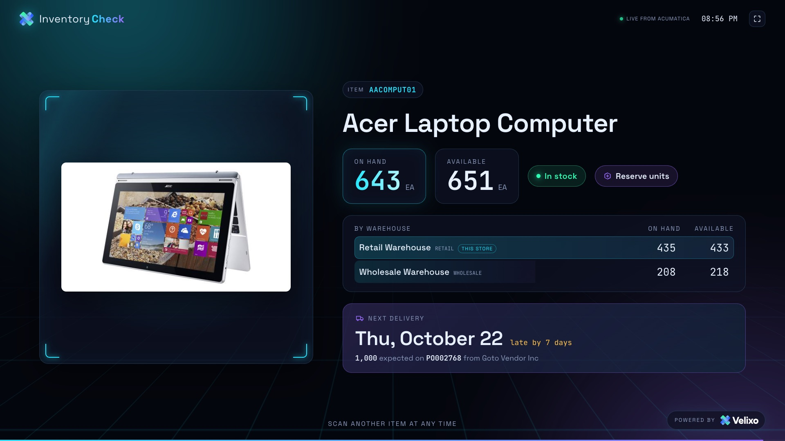
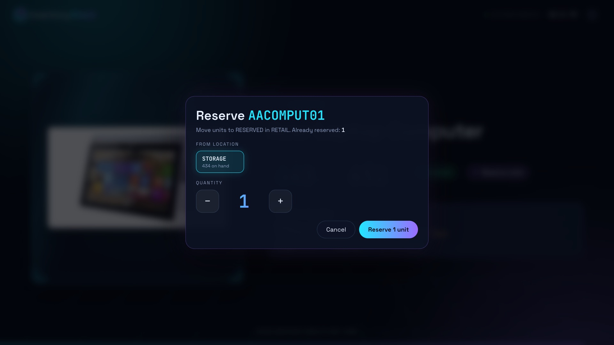
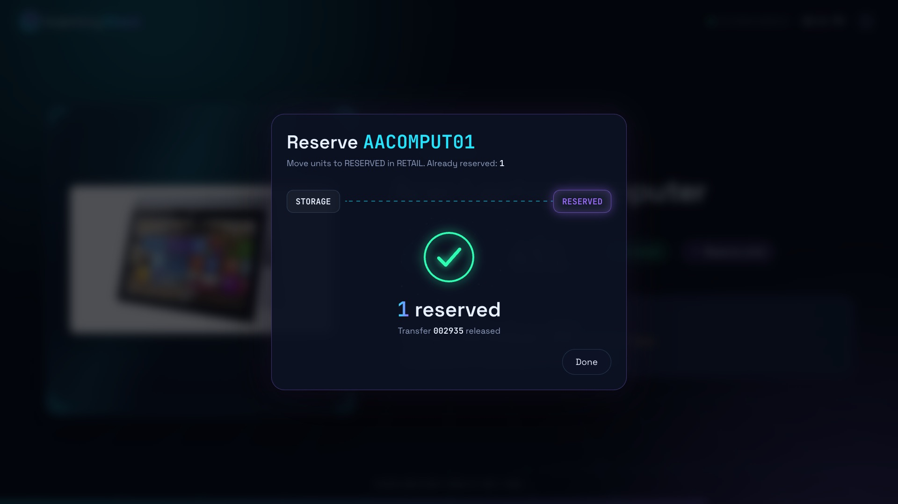

# Inventory checker

A full-screen kiosk for a store floor. Scan an item's barcode and the screen shows the item from Acumatica, live: its description and image, the quantity on hand and available, the same quantities for each warehouse, and when the next purchase order is expected to arrive. Staff can also move units to the store's `RESERVED` location with one tap, which runs an inventory transfer in Acumatica.



The checker is a small Node.js server with no dependencies and a web page. The server calls the Velixo CLI for every scan, so the sample shows how an app can use the CLI as its ERP back end: four queries and two command batches, each built with `velixo query build` or `velixo command build` and kept as a file. [PROMPT.md](PROMPT.md) tells how it was built with Claude Code.

## What you need

- Node.js 20 or later.
- The Velixo CLI, signed in: `velixo login`. See the [installation steps](../../README.md#installation). The checker needs the first CLI release after 0.3.1: it runs several CLI commands at the same time, and its image download relies on a batch that only reads running without `--yes`.
- An Acumatica connection. Check it with `velixo connections list`.
- A barcode scanner that types the code and presses Enter, as most USB and Bluetooth scanners do. Without one, type the code on a keyboard, or tap **Type a code instead** on a touch screen.

## Run it

```sh
cd samples/inventorychecker
VELIXO_CONNECTION=my-acumatica KIOSK_WAREHOUSE=RETAIL npm start
```

Open <http://localhost:8080> and scan an item. Tap the screen once to go full screen. Without `KIOSK_WAREHOUSE`, the checker only reads: it shows no **Reserve units** button.

On a dedicated kiosk computer, open the page in Chrome's kiosk mode, which hides the browser and keeps it full screen:

```sh
# macOS
open -a "Google Chrome" --args --kiosk http://localhost:8080
# Windows
start chrome --kiosk http://localhost:8080
# Linux
google-chrome --kiosk http://localhost:8080
```

| Variable | Default | Meaning |
|---|---|---|
| `VELIXO_CONNECTION` | the profile's default | The Acumatica connection to read. |
| `KIOSK_WAREHOUSE` | none | The store's warehouse. The warehouse list marks it as **This store**, and reserving moves units within it. Without it, reserving is off. |
| `KIOSK_RESERVE_LOCATION` | `RESERVED` | The location in that warehouse that reserved units move to. |
| `PORT` | `8080` | The port of the web page. |
| `HOST` | `127.0.0.1` | The address the server listens on. Set `0.0.0.0` to serve a screen on another device: anyone on the network can then look up items, and reserve units when reserving is on. |
| `VELIXO_BIN` | `velixo` | The path of the CLI. |
| `KIOSK_INTENT` | `Look up a scanned item at the in-store inventory kiosk` | The intent the CLI records for each lookup. |
| `KIOSK_RESERVE_INTENT` | `Move units of a scanned item to the reserved location from the in-store kiosk` | The intent the CLI records for each transfer. |
| `KIOSK_PASSWORD` | none | A password the browser asks for before it shows the kiosk, with any user name. Set it whenever the kiosk is reachable from the internet: anyone who opens the page can reserve units. |
| `KIOSK_IMAGE_CACHE` | `.cache/images` | Where the checker keeps the item images it downloaded. |

Every other setting of the CLI applies too, such as `VELIXO_PROFILE` and `VELIXO_ENV`.

## Run it in a container

The `Dockerfile` installs the Velixo CLI from `cli.velixo.com` and keeps the CLI's sign-in and the image cache under `/data`. Mount a volume there, so a restart keeps the sign-in:

```sh
docker build -t inventory-checker .
docker run -it --rm -v kiosk-data:/data inventory-checker velixo login --no-browser
docker run -d -v kiosk-data:/data -e VELIXO_CONNECTION=<connection> -p 8080:8080 inventory-checker
```

`--build-arg VELIXO_VERSION=<version>` pins a CLI release.

## The reserved location

Reserving needs a `RESERVED` location in the store's warehouse whose quantity does not count as available. `velixo/add-location.batch.json` creates it on the Warehouses screen:

```sh
velixo command run --batch velixo/add-location.batch.json \
  --param Warehouse=RETAIL --param LocationID=RESERVED --param "Description=Reserved stock" \
  --dry-run
# then run it again with --yes instead of --dry-run
```

## How a scan works

1. The scanner types the inventory ID and presses Enter. The page sends it to `GET /api/items/<inventory ID>`.
2. The server runs `velixo/item.vql` for the item's description, base unit, image file name and quantities summed over every warehouse. No row means no stock item has that ID, and the page says so.
3. The server then runs two queries at the same time: `velixo/warehouses.vql` for the quantity on hand and available in each warehouse, and `velixo/on-order.vql` for the open purchase order lines that still have quantity to receive, earliest promised date first. The page shows the first line as the next delivery, and up to three more under it.
4. The page asks for the image. The first time, the server runs `velixo/item-image.batch.json`, which opens the item on the Stock Items screen and downloads the one attachment that the item's image names. The server keeps the file, so every later scan of the item shows it at once.

A scan takes about half a second; the first scan of an item takes about one more for its image.

```sh
velixo query run --query velixo/item.vql --param "Inventory ID=AACOMPUT01"
velixo query run --query velixo/warehouses.vql --param "Inventory ID=AACOMPUT01"
velixo query run --query velixo/on-order.vql --param "Inventory ID=AACOMPUT01"
velixo command run --batch velixo/item-image.batch.json \
  --param InventoryID=AACOMPUT01 --param ImageFile=AACOMPUT01.jpg \
  --download-dir images
```

## How reserving works



1. **Reserve units** on the item opens a panel. The server runs `velixo/locations.vql` for the item's stock in each location of the store's warehouse, and the panel lists every location that holds some, apart from `RESERVED`.
2. Staff pick the location and the quantity, and tap **Reserve**. The page sends `POST /api/items/<inventory ID>/reserve` with the two.
3. The server runs `velixo/reserve-transfer.batch.json`, which creates a one-step transfer on the Transfers screen from that location to `RESERVED`, takes it off hold and releases it. That takes about 8 seconds. When Acumatica refuses the transfer, for example because the location no longer holds the quantity, the panel says so.
4. The panel shows the transfer number, and the item's available quantities count down to their new values.



```sh
velixo command run --batch velixo/reserve-transfer.batch.json \
  --param Warehouse=RETAIL --param InventoryID=AACOMPUT01 \
  --param FromLocation=STORAGE --param ToLocation=RESERVED --param Quantity=1 \
  --param "Description=Inventory checker: reserve 1 AACOMPUT01" --dry-run
```

This is a proof of concept, so anyone at the screen can reserve units. A real store would ask staff to sign in first.

## Tests

```sh
npm test
```

The tests start the server with a fake `velixo` (`test/fake-velixo.mjs`) that answers with JSON the real CLI printed against an Acumatica demo company (`test/fixtures/`). They need no ERP and no sign-in, and they check what the server sends to the CLI as well as what it answers: the lookups, the image cache, the reserve requests, the error answers and the paths the server refuses to serve. The fake CLI is an executable script, so they run on macOS and Linux.

`npm run test:live` runs the server against the real CLI and an Acumatica connection, and only reads:

```sh
INVENTORYCHECKER_LIVE_CONNECTION=my-acumatica INVENTORYCHECKER_LIVE_ITEM=AACOMPUT01 npm run test:live
```

## Making it yours

The files in `velixo/` came from these requests, and you can build your own the same way:

```sh
velixo query build "For the stock item whose inventory ID is {{InventoryID}}: its inventory ID, description, base unit, image URL, and its quantity on hand and quantity available, each summed across all warehouses" --save velixo/item.vql
velixo query build "Open purchase order lines for the stock item whose inventory ID is {{InventoryID}} that still have quantity to receive: the order number, the line's promised date, the quantity still to receive in the base unit, and the vendor name, sorted by promised date ascending" --save velixo/on-order.vql
velixo command build "Read the image files attached to the stock item with inventory ID {{InventoryID}}" --save velixo/item-image.batch.json
velixo command build "Create a one-step inventory transfer in warehouse {{Warehouse}} that moves {{Quantity}} units of stock item {{InventoryID}} from location {{FromLocation}} to location {{ToLocation}} in the same warehouse, with the description {{Description}}, take it off hold and release it. Leave every other field, including the branch and the line project, at its default." --target IN304000 --save velixo/reserve-transfer.batch.json
velixo command build "Add a location with location ID {{LocationID}} and description {{Description}} to the existing warehouse {{Warehouse}}. The location is active, and its quantity is not included in the available quantity. Leave every other field at its default." --save velixo/add-location.batch.json
```

`warehouses.vql` and `locations.vql` were written by hand, and two of the built files were edited:

- `on-order.vql` declares its parameter on the inventory ID's code, `InventoryItem.InventoryCD`, as `item.vql` does. The builder declared it on `POLine.InventoryID`, a selector, and Acumatica then fails the whole query for an ID it does not know, instead of returning no rows.
- `item-image.batch.json` is two commands: a `Key` that opens the item, and one `DownloadAttachments` for the file the item's image names, `{{ImageFile}}`. The builder added a `Clear` and downloaded every image attached to the item.

Ideas to take it further:

- Look up barcodes that are not inventory IDs through the item's cross-references (`INItemXRef`).
- Show the item's price from its price list.
- Ask staff to sign in before they reserve units.

## Two things to know about the CLI

- **A batch that only reads runs like a query.** The image download sets the item's ID and downloads a file, with no save, so it needs no `--yes` and the CLI's duplicate guard leaves it alone. The reserve transfer writes: the server passes `--yes`, and `--force` too, because reserving the same quantity twice is meant to make two transfers.
- **Run a saved query from its file in an app.** `velixo query run NAME` and `velixo query run --query FILE` print the result in two different shapes. A file also travels with the app.

## Files

| File | What it does |
|---|---|
| `Dockerfile` | The kiosk in a container, with the CLI from `cli.velixo.com`. |
| `server.mjs` | Serves the page and the API, and runs the CLI. |
| `public/` | The page: `index.html`, `styles.css`, `app.js` and the Velixo logos. |
| `velixo/item.vql` | The item and its total quantities. |
| `velixo/warehouses.vql` | The item's quantities in each warehouse. |
| `velixo/on-order.vql` | The open purchase order lines of the item. |
| `velixo/locations.vql` | The item's quantity in each location of one warehouse. |
| `velixo/item-image.batch.json` | Downloads the item's image from the Stock Items screen. |
| `velixo/reserve-transfer.batch.json` | Moves units to the reserved location with a released transfer. |
| `velixo/add-location.batch.json` | Adds the reserved location to a warehouse. |
| `test/` | The tests, the fake CLI and its fixtures. |
| `PROMPT.md` | How the sample was built. |
